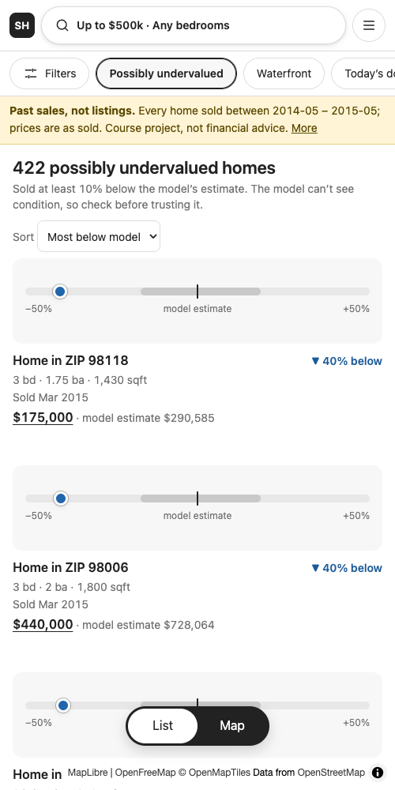
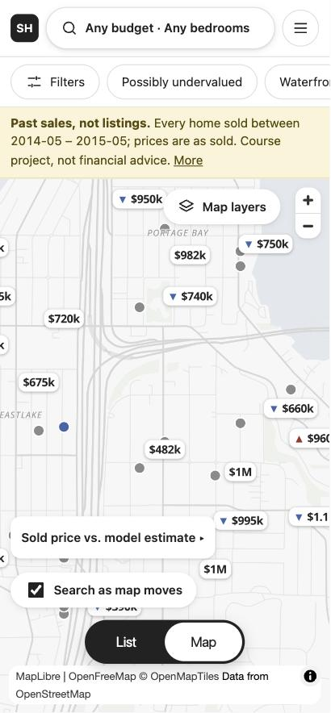

# Seattle Home Value Finder

Explore every home that sold in King County, Washington between May 2014 and May 2015, and see which sold for much
less (or more) than a price model expected. An interactive map and list with shareable links, built as the polished
follow-up to my INFO 5002 (Introduction to Python) final project at Northeastern University.

**Live site: https://seattle-home-value-finder.pages.dev**

By Daisy Tang. The graded course version (linear regression, R² 0.647, single-file Leaflet page) is kept unchanged and is
still reachable from this site's About page.

| Desktop | Phone: list | Phone: map |
|---|---|---|
|  |  |  |

(The desktop image is small because the browser pane used to capture it is small; the phone list was captured with a
headless browser, which does not draw map tiles, so it is the list only.)

## What it does

The first screen answers one question: **which homes sold for at least 10% less than a price model expected, within my
budget?** It opens on Seattle and Bellevue with "Possibly undervalued" and a $500k budget already chosen.

- **A search pill with three parts** (ZIP code, budget ceiling, bedrooms), a row of chips (Filters, Possibly undervalued,
  Waterfront, Today's dollars), and a Filters window for everything else (minimum price, baths, size, year built, which
  price basis). The Filters button shows how many homes it will give you.
- **A quiet map.** The base map is OpenStreetMap data (served by OpenFreeMap) restyled to pale grey-white with thin pale
  roads and no buildings, rail lines or road names. Every sale is a small dot; the best-ranked ones also get a white
  price pill (`▼ $350k`), as many as fit. Hover a card and its pill turns dark; sales you have opened turn pale grey.
- **A model estimate with its error, not just a verdict.** Every sale has a gradient-boosting estimate from a model that
  never saw it (5-fold, grouped by house). Cards have no photo (the data has none), so each leads with a bar from −50% to
  +50% of the estimate: the grey band is the model's typical error, the tick is the estimate, the dot is what it sold for.
- **Optional area colouring** (*Map layers*): smoothed hexagons or ZIP areas by price, in shades of grey so they never
  compete with the blue/red marks. Off by default.
- **Links that keep your view.** Budget, bedrooms, filters, map position and layers all live in the URL: copy the link and
  the same view opens. (Links made before the budget default existed, with no `maxp`, now open with the $500k default; use
  `maxp=any` for no limit.)
- **Today's dollars.** Restate 2014–15 prices with the Seattle Case-Shiller index, the FHFA ZIP index, or your own
  multiplier; a monthly-cost calculator and an income-based price range use the current mortgage rate.
- **ZIP pages and comparison** (price distribution and size-vs-price charts), similar sales, and an About page whose
  numbers are read from the generated model card. *Affordability* and *Compare* are links in the header.
- **English and 简体中文** (English is the default; `?lang=zh` in the link, or the choice you made earlier in the same browser, switches it) and
  **accessibility settings** (text size, high contrast, reduced animation, underlined links) in the menu. All interface
  text lives in `src/i18n/`; a test checks that every key exists in both languages.
- **Phone layout:** the search pill collapses to one button, the chips scroll sideways, and a List / Map switch floats at
  the bottom. See [docs/perf-results.md](docs/perf-results.md) for the measurements behind these claims.

## Design rules

Every colour, weight and control has one job, and `scripts/color_audit.py` fails if that is broken.

| Element | Meaning |
|---|---|
| Near-black fill, black outline | Primary action, selected state; a hovered or selected price pill turns near-black |
| Light-grey outline | A control you can switch |
| **Blue** (dot, ▼, bar marker, card gap text) | Sold **below** the model estimate. Data only. |
| **Red** (dot, ▲, bar marker, card gap text) | Sold **above** the model estimate. Data only. |
| Grey dot | Close to the estimate |
| Amber | A caveat: the past-sales banner, an "Unusual sale" tag |
| Shades of grey (optional layer) | Price per square foot, or ZIP price, by lightness only |
| Bold (600) | Prices and headings; everything else is regular (400) |
| Small grey text | Secondary facts: specs, dates, sources |

Blue and red never appear on buttons, links or backgrounds, and the marker colours stay at least 30 ΔE apart under
colour-blindness simulation (`scripts/cvd_check.py`), with arrows and numbers repeating what colour says.

What it is not: the data are *past sales*, not listings; there are no photos, addresses, schools or commute data, and
"below the model" is not "a bargain" (the model cannot see condition). The page says so, and flags very large gaps as
unusual sales.

## Run it

Needs Node 22+ (developed on 25) and, only to regenerate the data, Python 3.13.

```bash
npm install
npm run dev          # http://localhost:5173
npm test             # vitest
npm run build && npm run check-size
```

The site is static: `public/data/v1/` already contains the generated data.

### Regenerate the data (offline pipeline)

```bash
python3 -m venv pipeline/.venv
pipeline/.venv/bin/pip install -r pipeline/requirements.txt
pipeline/.venv/bin/python -m pipeline.build          # model, H3 hexagons, ZIP polygons, FRED/FHFA indexes, per-ZIP chunks
pipeline/.venv/bin/python -m pytest pipeline         # invariants: row counts, no leakage, size budgets, h3 vs h3-js
```

The statewide ZIP file is read from the course folder (`config.STATE_ZCTA`); the 70 King County polygons are cached in
`data/raw/`. Downloads (FRED, FHFA) are cached in `data/work/` (git-ignored).

## How it is built

- **Front end:** Vite, React, TypeScript, React Router, MapLibre GL (OpenFreeMap Positron tiles, restyled in
  `src/map/quietStyle.ts`), Recharts (loaded only on chart pages). First screen: about 81 KB of gzipped JavaScript; the lazily loaded map adds about 415 KB, and the other pages and
  charts load on demand.
- **Data layer:** `src/data/client.ts` caches JSON, merges identical in-flight requests and cancels a shared request only
  when every caller has gone. Per-ZIP chunks load as the (debounced) viewport touches them; chunk arrivals are batched.
  Request counters are on `window.__hvf.metrics`; `?debug=1` shows them.
- **State:** the URL is the single source of truth for filters and viewport (`src/lib/filters.ts`).
- **Pipeline:** `pipeline/` (Python) trains the model out-of-fold, aggregates H3 cells with hierarchical shrinkage
  (k chosen by leave-one-out), simplifies ZIP polygons with mapshaper (topology preserved), and writes the static files.

## Deploy

Cloudflare Pages by direct upload, so nothing needs access to the repository:

```bash
npx wrangler login          # once
npx wrangler pages project create seattle-home-value-finder --production-branch main --force   # once; --force keeps it on
                            # classic Pages (recent Wrangler otherwise redirects static projects created by agents to Workers)
scripts/deploy.sh           # lint, test, build, size check, upload dist/
```

`dist/` must not contain a `404.html` (Cloudflare then falls back to `index.html` for deep links); `check-size` enforces it.

## Data and credits

- Home sales: Kaggle, "House Sales in King County, USA" (not re-checked for licence; only derived JSON is published).
- Base map: © OpenStreetMap contributors, OpenMapTiles, served by OpenFreeMap; MapLibre GL JS.
- Price indexes: S&P Dow Jones Indices (Case-Shiller Seattle) and Freddie Mac rates via FRED (Federal Reserve Bank of St.
  Louis); FHFA House Price Index (ZIP5, developmental).
- ZIP boundaries: U.S. Census Bureau ZCTAs. Colour scales: ColorBrewer.
- Code: MIT, see [LICENSE](LICENSE).
