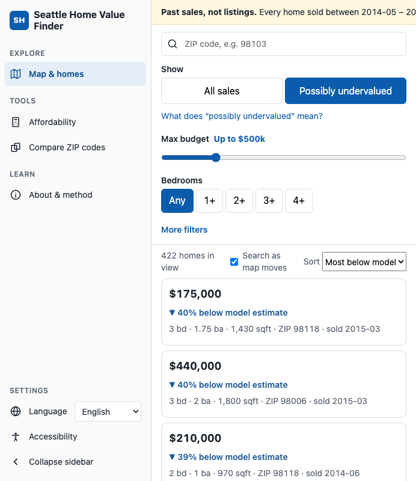
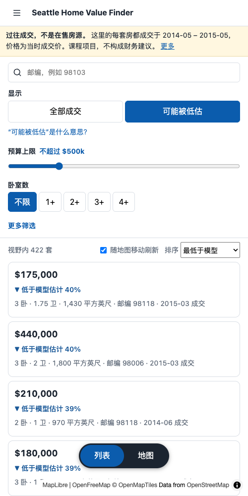
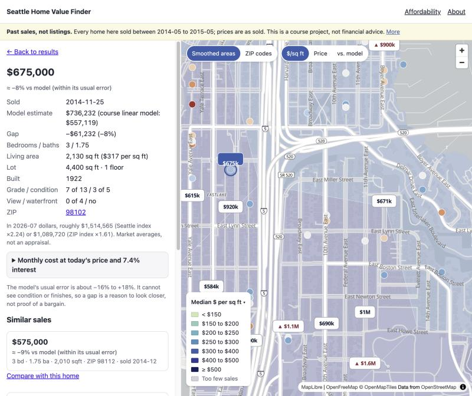
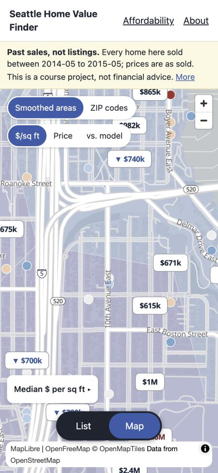

# Seattle Home Value Finder

Explore every home that sold in King County, Washington between May 2014 and May 2015, and see which sold for much
less (or more) than a price model expected. An interactive map and list with shareable links, built as the polished
follow-up to my INFO 5002 (Introduction to Python) final project at Northeastern University.

**Live site: https://seattle-home-value-finder.pages.dev**

By Daisy Tang. The graded course version (linear regression, R² 0.647, single-file Leaflet page) is kept unchanged and is
still reachable from this site's About page.

| First screen (sidebar, controls, results) | Phone, Chinese | Home detail | Phone map |
|---|---|---|---|
|  |  |  |  |

(The first-screen image is cropped to the sidebar and results panel because the headless browser used for it does not
draw map tiles.)

## What it does

The first screen answers one question: **which homes sold for at least 10% less than a price model expected, within my
budget?** It opens on Seattle and Bellevue with "Possibly undervalued" and a $500k budget already chosen, and everything
else sits one step deeper.

- **Four controls up front:** a ZIP search, *Show* (All sales / Possibly undervalued, with a plain-language explanation),
  a budget slider and bedrooms. Baths, size, year built, waterfront, minimum price and "show prices in today's dollars"
  are under *More filters*.
- **Smooth map instead of hard ZIP edges.** Zoomed out, hexagonal areas (H3) are coloured by median price per square
  foot, shrunk toward their surroundings where sales are few and greyed out below three sales. Zoomed in you get clusters,
  dots and `$840k` price bubbles. ZIP-code polygons are an optional layer (*Map layers* button).
- **A model estimate with its error, not just a verdict.** Every sale has a gradient-boosting estimate from a model that
  never saw it (5-fold, grouped by house), shown as `▼ 25% below model estimate`, plus the model's typical error band.
- **Links that keep your view.** Budget, bedrooms, filters, map position and layer all live in the URL: copy the link and the
  same view opens. (Links made before the budget default existed, with no `maxp`, now open with the $500k default; use
  `maxp=any` for no limit.)
- **List and map linked both ways.** Hover a card to highlight its marker and back; selecting a sale is a route
  (`/home/:id`), so it survives redraws and can be shared.
- **Today's dollars.** Restate 2014–15 prices with the Seattle Case-Shiller index, the FHFA ZIP index, or your own
  multiplier; a monthly-cost calculator and an income-based price range use the current mortgage rate.
- **ZIP pages and comparison** (price distribution and size-vs-price charts), similar sales, and an About page whose
  numbers are read from the generated model card.
- **A small sidebar:** Map & homes, Affordability, Compare ZIP codes, About & method, plus language and accessibility
  settings. It collapses to an icon rail on narrower windows (remembered) and becomes a drawer on phones.
- **English and 简体中文**, switchable from the sidebar (`?lang=zh` in the link keeps the choice; the browser language is
  the default). All interface text lives in `src/i18n/`; a test checks that every key exists in both languages.
- **Accessibility settings** (sidebar): text size, high contrast, reduced animation, underlined links. They are
  saved in the browser only and applied before first paint.
- **Phone layout, keyboard use, colour-blind-safe palettes.** See [docs/perf-results.md](docs/perf-results.md) for the
  measurements behind these claims.

What it is not: the data are *past sales*, not listings; there are no photos, addresses, schools or commute data, and
"below the model" is not "a bargain" (the model cannot see condition). The page says so, and flags very large gaps as
unusual sales.

## Run it

Needs Node 22+ (developed on 25) and, only to regenerate the data, Python 3.13.

```bash
npm install
npm run dev          # http://localhost:5173
npm test             # vitest
npm run build && npm run check-size
```

The site is static: `public/data/v1/` already contains the generated data.

### Regenerate the data (offline pipeline)

```bash
python3 -m venv pipeline/.venv
pipeline/.venv/bin/pip install -r pipeline/requirements.txt
pipeline/.venv/bin/python -m pipeline.build          # model, H3 hexagons, ZIP polygons, FRED/FHFA indexes, per-ZIP chunks
pipeline/.venv/bin/python -m pytest pipeline         # invariants: row counts, no leakage, size budgets, h3 vs h3-js
```

The statewide ZIP file is read from the course folder (`config.STATE_ZCTA`); the 70 King County polygons are cached in
`data/raw/`. Downloads (FRED, FHFA) are cached in `data/work/` (git-ignored).

## How it is built

- **Front end:** Vite, React, TypeScript, React Router, MapLibre GL (OpenFreeMap Positron tiles), Recharts (loaded only on
  chart pages). First screen: about 81 KB of gzipped JavaScript; the lazily loaded map adds about 415 KB, and the other pages and
  charts load on demand.
- **Data layer:** `src/data/client.ts` caches JSON, merges identical in-flight requests and cancels a shared request only
  when every caller has gone. Per-ZIP chunks load as the (debounced) viewport touches them; chunk arrivals are batched.
  Request counters are on `window.__hvf.metrics`; `?debug=1` shows them.
- **State:** the URL is the single source of truth for filters and viewport (`src/lib/filters.ts`).
- **Pipeline:** `pipeline/` (Python) trains the model out-of-fold, aggregates H3 cells with hierarchical shrinkage
  (k chosen by leave-one-out), simplifies ZIP polygons with mapshaper (topology preserved), and writes the static files.

## Deploy

Cloudflare Pages by direct upload, so nothing needs access to the repository:

```bash
npx wrangler login          # once
npx wrangler pages project create seattle-home-value-finder --production-branch main --force   # once; --force keeps it on
                            # classic Pages (recent Wrangler otherwise redirects static projects created by agents to Workers)
scripts/deploy.sh           # lint, test, build, size check, upload dist/
```

`dist/` must not contain a `404.html` (Cloudflare then falls back to `index.html` for deep links); `check-size` enforces it.

## Data and credits

- Home sales: Kaggle, "House Sales in King County, USA" (not re-checked for licence; only derived JSON is published).
- Base map: © OpenStreetMap contributors, OpenMapTiles, served by OpenFreeMap; MapLibre GL JS.
- Price indexes: S&P Dow Jones Indices (Case-Shiller Seattle) and Freddie Mac rates via FRED (Federal Reserve Bank of St.
  Louis); FHFA House Price Index (ZIP5, developmental).
- ZIP boundaries: U.S. Census Bureau ZCTAs. Colour scales: ColorBrewer.
- Code: MIT, see [LICENSE](LICENSE).
